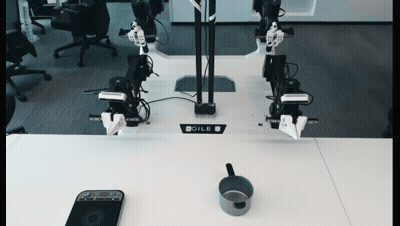
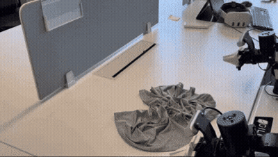

# ARX5-VLA

Imitation learning and vision-language-action policies for the **ARX X5 robotic arm** — from teleoperation and data collection to training, human corrections, and real-robot deployment.

Built on [OpenDriveLab/kai0](https://github.com/OpenDriveLab/kai0) and [openpi](https://github.com/Physical-Intelligence/openpi), with ARX-specific collection tools, single-arm diffusion policies, and deployment workflows.

## Demo

<table>
  <tr>
    <th align="center">ARX5-VLA</th>
    <th align="center">ARX5-VLA</th>
  </tr>
  <tr>
    <td align="center"><a href="docs/arx_demo.mp4"></a></td>
    <td align="center"></td>
  </tr>
</table>

[Watch the original demo video](docs/arx_demo.mp4)

## Workflow

**Set up the robot → collect demonstrations → convert datasets → train → deploy → collect corrections.**

| Step | Documentation | Code |
| --- | --- | --- |
| Hardware and teleoperation | [机械臂驱动说明](docs/notes/机械臂驱动说明.md) · [ARX calibration](https://github.com/HARROLDX/ARX_calibration_ros) | [ARX X5 drivers](https://github.com/ARXroboticsX/ARX_X5) |
| Collection and replay | [数据采集流程笔记](docs/notes/数据采集流程笔记.md) | [ARX collection tools](train_deploy_alignment/dagger/arx/) |
| Dataset preparation | [Dataset guide](docs/dataset.md) · [Normalization](docs/norm_stats_fast.md) | [Conversion and augmentation](train_deploy_alignment/data_augment/) |
| Training | [运行与流程笔记](docs/notes/运行与流程笔记.md) | [Training configurations](src/openpi/training/config.py) · [Diffusion policy](src/openpi/model_dp/) |
| Deployment | [ARX inference](train_deploy_alignment/inference/arx/README.md) · [Remote inference](docs/tda_remote_inference.md) | [ARX inference clients](train_deploy_alignment/inference/arx/) |
| Corrections and post-training | [ARX DAgger](train_deploy_alignment/dagger/arx/README.md) · [Stage Advantage / AWBC](stage_advantage/README.md) | [DAgger](train_deploy_alignment/dagger/) · [Stage Advantage](stage_advantage/) |

The Chinese notes preserve experiment-specific commands and paths. Adapt camera serials, datasets, checkpoints, robot topics, and host addresses to your setup. They are working records, not a portable one-command installer.

## Getting started

Clone this repository:

```bash
git clone --recurse-submodules https://github.com/HARROLDX/ARX5-VLA.git
cd ARX5-VLA
```

For the **training / policy-server environment**, use Python 3.11 or later and the repository's `uv` configuration:

```bash
GIT_LFS_SKIP_SMUDGE=1 uv sync
GIT_LFS_SKIP_SMUDGE=1 uv pip install -e .
```

The **robot-side ROS2 client** uses a separate environment; follow the [ARX inference setup](train_deploy_alignment/inference/arx/README.md). Select the relevant workflow above before starting collection, training, or deployment. Real-robot execution requires verified calibration and on-site supervision.

## Repository layout

```text
docs/                       Documentation index, experiment notes and demo assets
src/openpi/                 Models, training configs, data processing and policies
scripts/                    Training, normalization, conversion and policy serving
packages/openpi-client/     Client library for communicating with the policy server
train_deploy_alignment/     Data augmentation, DAgger and robot inference
stage_advantage/            Advantage annotation and AWBC workflows
model_arithmetic/           Checkpoint mixing and weight optimization
```

See the [documentation index](docs/README.md) for all guides. Detailed upstream methods, examples, and citation are retained in the [kai0 reference](docs/kai0-reference.md); upstream benchmark results are not ARX5-specific evaluation results.

## Acknowledgements and license

Thanks to [OpenDriveLab/kai0](https://github.com/OpenDriveLab/kai0), [Physical Intelligence/openpi](https://github.com/Physical-Intelligence/openpi), and [ARX Robotics](https://github.com/ARXroboticsX/ARX_X5).

See [LICENSE](LICENSE) and [LICENSE_GEMMA.txt](LICENSE_GEMMA.txt). Upstream datasets, checkpoints, and third-party components retain their respective license terms. The [kai0 citation](docs/kai0-reference.md#license-and-citation) is provided with the upstream reference.
